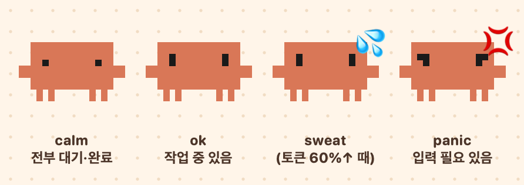
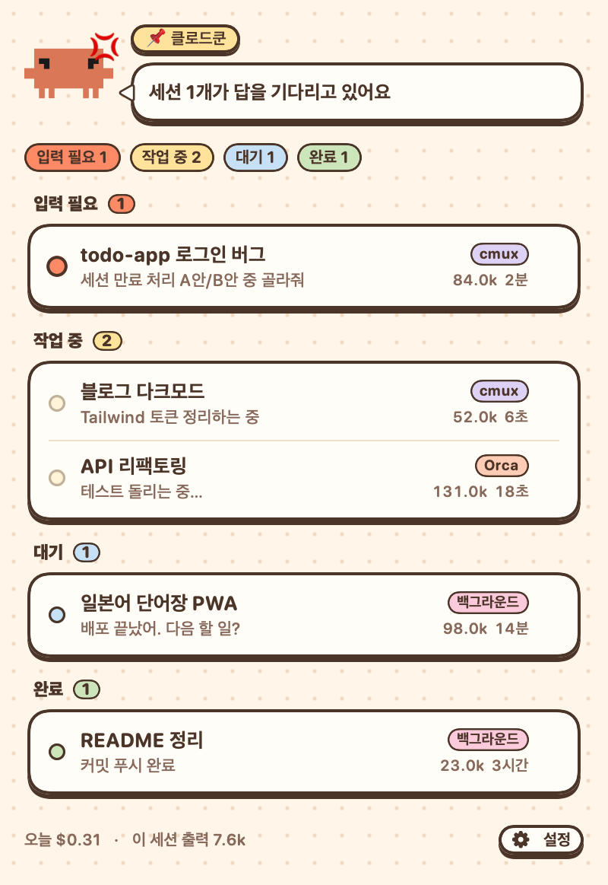
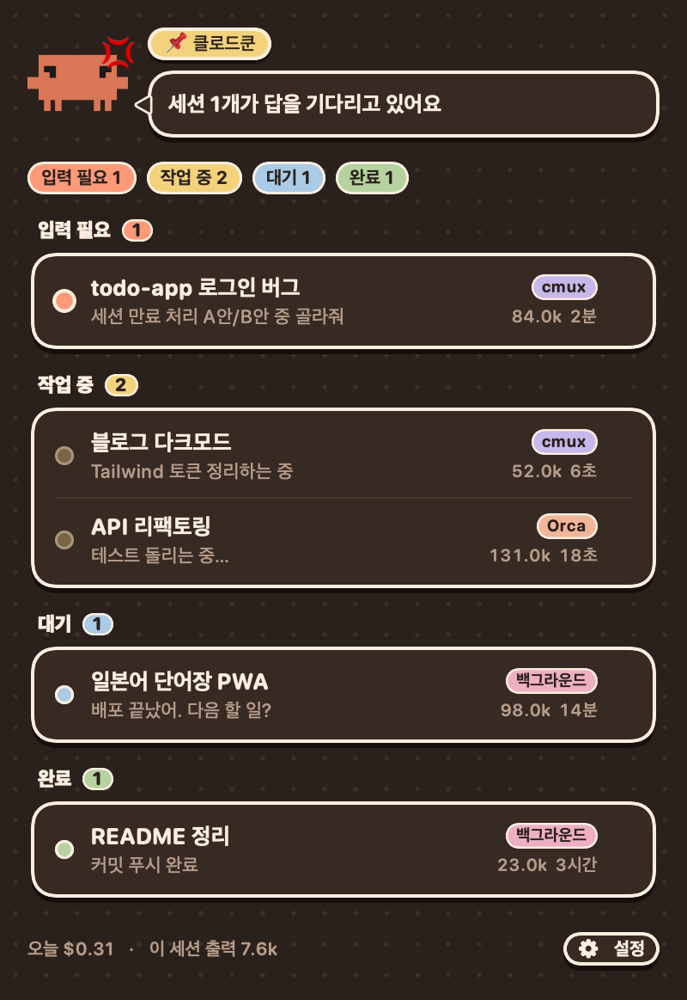
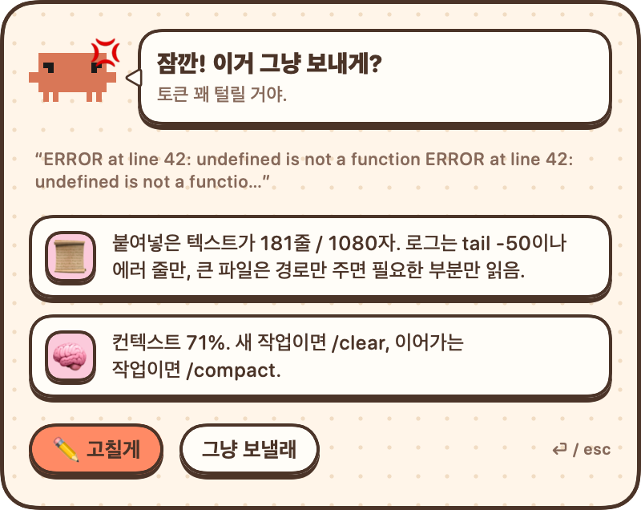

<div align="center">



# 클로드쿤 · クロードくん

**지금 돌고 있는 Claude Code 세션, 메뉴바에서 한눈에.**

macOS 메뉴바에 사는 작은 Claude Code 세션 비서.<br>
어느 세션이 대답을 기다리는지 보고, 클릭 한 번으로 그 터미널 탭으로 넘어가요.

</div>

---

## 이런 화면이에요

<p align="center">
  
  &nbsp;&nbsp;
  
</p>

- **상태별 묶음** — `입력 필요` · `작업 중` · `대기` · `완료` 순으로 정렬. 대답 기다리는 세션이 항상 맨 위.
- **클릭하면 그 탭으로** — cmux / Orca 에서 연 세션은 해당 워크스페이스·탭으로 바로 이동. 백그라운드 세션은 붙어 있는 탭을 찾아가고, 없으면 새로 attach.
- **이름 바꾸기 ✏️** — 행에 마우스를 올려 연필을 누르면 그 세션에 `/rename` 을 대신 입력. 목록엔 즉시 반영(낙관적 업데이트), 실패하면 원래대로.
- **종료 / 지우기** — 살아 있는 세션은 `종료` (대화는 남아서 `claude --resume` · `claude attach` 로 이어가기 가능). 이미 끝난 백그라운드 세션은 `지우기` 로 목록 정리.
- **오늘 비용 · 세션 출력 토큰** — 하단에 작게.
- **한국어 / 日本語** — `⚙ 설정` 에서 전환.

### 메뉴바 아이콘 표정

| calm | ok | sweat | panic |
|:-:|:-:|:-:|:-:|
| 전부 대기·완료 | 작업 중인 세션 있음 | 컨텍스트 60%↑ | 입력 기다리는 세션 있음 |

## (선택) 토큰 절약 코치

<p align="center"></p>

Claude Code 훅을 연결하면 프롬프트가 **전송되기 전에** 한 번 살펴봐요.

- 로그를 통째로 붙여넣었을 때 → "에러 줄만 / 경로만 주세요"
- 컨텍스트가 60% 넘었을 때 → `/clear` · `/compact` 제안
- 짧은 질문을 Opus 로 보낼 때 → Sonnet 제안 등

`고칠게` 를 누르면 전송이 막히고 팁이 터미널에 표시돼요. 같은 프롬프트를 그대로 한 번 더 보내면 통과합니다.
앱이 꺼져 있으면 훅은 아무것도 막지 않아요 (fail-open).

## 설치

요구사항: macOS 14+, Swift 5.9+ (Xcode 또는 Command Line Tools), [Claude Code](https://claude.com/claude-code)

```bash
git clone https://github.com/chromeheartz/claude-kun.git
cd claude-kun
swift build -c release
.build/release/ClaudeKun &
```

로그인할 때 자동으로 켜고 싶으면 `시스템 설정 → 일반 → 로그인 항목` 에 `.build/release/ClaudeKun` 을 추가하세요.

### 토큰 코치 훅 연결 (선택)

`~/.claude/settings.json` 의 `hooks` 에 추가 (기존 훅은 그대로 두고 배열에 항목만 추가):

```json
"UserPromptSubmit": [{ "hooks": [{ "type": "command", "command": "node /path/to/claude-kun/hook/tokenwatch-hook.js", "timeout": 120 }] }],
"Stop":             [{ "hooks": [{ "type": "command", "command": "node /path/to/claude-kun/hook/tokenwatch-hook.js", "timeout": 10 }] }]
```

### cmux 를 쓴다면

cmux 는 기본적으로 cmux 안에서 띄운 프로세스만 소켓 접속을 허용해요. 메뉴바 앱에서 탭 이동·이름 바꾸기를 하려면:

1. cmux 설정에서 소켓 접근 모드를 **Password** 로 바꾸고 비밀번호 지정
2. cmux 재시작 (⌘Q 후 다시 열기)
3. 클로드쿤 `⚙ 설정` 에 같은 비밀번호 입력 (`~/.token-watch/cmux-password`, 권한 600 으로 저장)

## 어떻게 동작하나요

| 하는 일 | 쓰는 것 |
|---|---|
| 세션 목록 | `claude agents --json --all` 을 3초마다 |
| 세션이 어느 탭인지 | 프로세스 환경변수 (`CMUX_SURFACE_ID`, `ORCA_TAB_ID` …) |
| 탭 이동 | `cmux focus-panel` / `orca terminal switch` |
| 이름 바꾸기 | 그 탭에 `/rename <이름>` 입력 |
| 종료 | 백그라운드 `claude stop`, 터미널 세션 SIGTERM, 끝난 백그라운드 `claude rm` |
| 토큰 집계 | `~/.claude/projects/**/*.jsonl` 의 `usage` |

외부 서버로 아무것도 보내지 않아요. 전부 로컬 CLI와 파일만 읽습니다.

## 개발용 플래그

```bash
.build/release/ClaudeKun --agents          # 수집한 세션 목록 출력
.build/release/ClaudeKun --check           # 토큰 규칙 자체 점검
.build/release/ClaudeKun --render [dark]   # README 스크린샷 렌더 (/tmp/tw-*.png, 가짜 데이터)
```

---

<details>
<summary>🇯🇵 日本語</summary>

**クロードくん** は macOS のメニューバーに住む Claude Code セッション見守りアプリです。

- 動いているセッションを「入力待ち・作業中・待機・完了」に分けて表示
- クリックで cmux / Orca の該当タブへジャンプ
- ✏️ で名前変更(`/rename` を代わりに入力)、終了・削除もメニューから
- (任意)フックを繋ぐと、送信前にトークンを無駄遣いしそうなプロンプトを止めてヒントを表示
- 設定で 한국어 / 日本語 を切り替え

インストールは上の「설치」を参照してください。

</details>

> 클로드쿤은 개인이 만든 비공식 도구예요. Anthropic 과 관련이 없고, Claude 는 Anthropic 의 상표입니다.
> 非公式の個人プロジェクトです。Anthropic とは関係ありません。

## License

MIT
